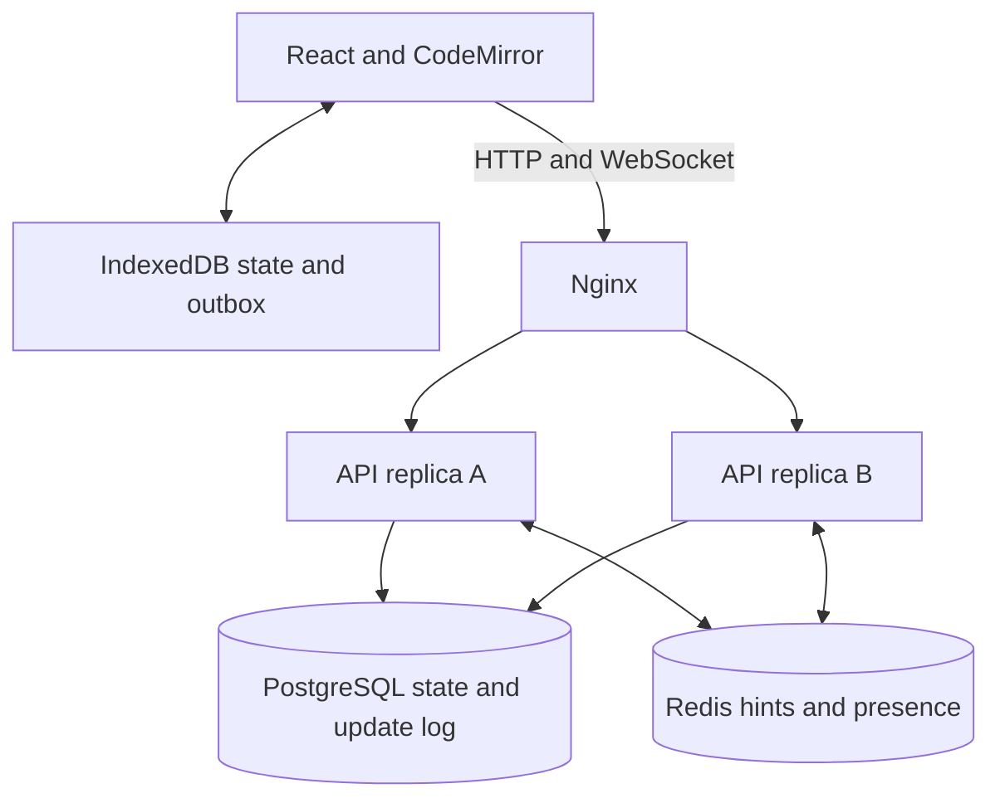

# Converge Desk

[](https://github.com/Karthikvk1899/converge-desk/actions/workflows/ci.yml)

A collaborative Markdown workspace for engineering runbooks and incident handoffs. Two engineers can edit the same document, continue editing through a connection loss, and merge their work when they reconnect. A visible retry queue distinguishes **saved on this browser** from **acknowledged by the server**.

Built with React, TypeScript, CodeMirror, Yjs, Fastify, PostgreSQL, Redis, WebSockets, and Docker. MIT licensed.

## Try it in five minutes

Prerequisites: Git, Node.js 24+, Docker Engine with Compose v2, and approximately 4 GB available RAM. Ports 3000, 8081, and 8082 must be free. No cloud account or npm install is needed for the Docker quick start.

```bash
git clone https://github.com/Karthikvk1899/converge-desk.git
cd converge-desk
node scripts/init-env.mjs
docker compose up -d --build --wait
docker compose exec -e API_A=http://localhost:8080 api1 node scripts/seed.ts
```

Open **http://localhost:3000** and paste Alice's printed credential. In a separate browser profile or private window, connect as Bob. Open **Incident response handoff** in both windows. Edit together, create a checkpoint, and fork that checkpoint into another document. The viewer credential can read but cannot write.

To try disconnection, use your browser's developer-tools network setting to go offline in one window. Continue writing; the status shows pending edits. Write something different in the other window, then reconnect the first. Both changes converge. The loaded app can edit offline; the application shell itself is not a PWA and does not support a first load without a network.

Credentials are generated locally and kept out of git. The seed command prints fresh credentials and creates a new demo each time it runs. Do not post its output. To stop while preserving documents, run `docker compose down`. To intentionally delete all local demo data, run `docker compose down -v`.

## What makes this project different

This project tackles concurrent human editing, browser persistence, and reconnection. It complements reconciliation (Ledger Bridge), admission control (Quota Forge), workflow compensation (Saga Harbor), webhook delivery (Relay Foundry), and stream monitoring (Signal Loom).

| Area | Working implementation |
| --- | --- |
| Frontend | Accessible CodeMirror editor, Markdown preview, presence, offline outbox, sync status, search, checkpoint and history panels, responsive layout |
| Backend | Authenticated HTTP and one-use WebSocket tickets; two interchangeable API replicas; bounded worker-thread validation |
| Data | Yjs CRDT state, transactional update log, operation deduplication, PostgreSQL full-text index, immutable checkpoints |
| Infrastructure | Compose with two replicas, Nginx, explicit migrations, health checks, non-root application containers |
| Operations | Database-backed catch-up, dependency interruption tests, history for investigation, recovery runbook, CI and CodeQL |

Kafka is deliberately absent: the database log already supplies ordered durable catch-up, and Redis notifications only reduce latency. Adding another durable broker would not resolve a requirement here.

## Consistency and failure behavior

1. Each edit is saved with a stable operation UUID in IndexedDB before transmission.
2. An API replica verifies the principal and locks the document row. A bounded worker validates and merges the Yjs update.
3. The update log, current CRDT snapshot, text search content, and sequence are committed in one PostgreSQL transaction.
4. Only after commit does the server acknowledge the operation. The browser then removes it from its outbox.
5. Other sessions consume ordered database updates. Redis publish/subscribe wakes them early; a two-second poll repairs lost notifications.

If an acknowledgment is lost, retrying the same operation returns its existing sequence. Reusing an operation UUID with different bytes or a different actor returns a conflict. Yjs also makes duplicate CRDT application idempotent. This is not a claim of exactly-once network delivery.

A checkpoint requires the caller's expected sequence. A stale caller receives a conflict; a fork creates a new independent CRDT document from checkpoint text without rewriting the original history. Checkpoints capture server text, not pending offline edits.



See [architecture](docs/architecture.md), [HTTP and WebSocket contracts](docs/contracts.md), [generated OpenAPI](docs/openapi.json), [operations](docs/operations.md), and [threat model](docs/threat-model.md).

## Verification

The workflow runs unit/UI tests, TypeScript checks, formatting, a production frontend build, dependency audit, Docker integration, Chromium collaboration tests, dependency failure tests, and CodeQL. Consult the linked CI run for the exact revision and result; the presence of a test does not prove it has passed on your platform.

```bash
npm ci
npm run lint
npm run typecheck
npm test
npm run build
npm audit --audit-level=moderate

# After starting the quickstart stack:
docker compose run --build --rm --no-deps integration
npx playwright install --with-deps chromium
set -a
. ./.env
set +a
npm run e2e
node scripts/faults.ts
node scripts/backup-restore.ts
```

The backup/restore rehearsal creates a uniquely named disposable database and checks restored credential hashes, checkpoints, CRDT state, idempotent retry, and continued editing. It removes only that test database.

The failure script intentionally stops the project's Redis, one API replica, and PostgreSQL, then restores them. Use it only against the local demo stack. Browser evidence is retained as a CI artifact for seven days.

Unit tests exercise CRDT convergence under reordering, duplicate application, deletion/insertion, malformed or oversized payloads, worker validation, IndexedDB reopening/concurrent writes, HTTP authorization boundaries, and sign-in behavior. Integration tests cover two-replica convergence, lost-ack retry, conflicting operation IDs, tenant isolation, viewer permissions, one-use tickets, Origin enforcement, revocation, checkpoint conflicts/forks, and indexed search. Browser tests cover simultaneous editing, offline merge, pending edits surviving a page close, checkpoints, and desktop/mobile overflow.

## Scope and honest limitations

This is a working reference system, not a production-qualified hosted product. There are no claimed throughput or latency benchmarks, AWS deployment, multi-region guarantees, or production availability results.

- Credentials are scoped opaque bearer tokens with editor/viewer roles per tenant. OIDC/SSO, granular document ACLs, invitations, and credential expiry are not implemented.
- PostgreSQL is a single node. Acknowledgment durability depends on its WAL/storage configuration. CI includes an isolated logical backup/restore rehearsal; production backup policy, failover, and regional disaster recovery are not qualified.
- Browser storage may be evicted or fail. The UI reports local persistence errors and offers Markdown export. Cached documents remain after disconnect; clearing site data removes them.
- Update history and checkpoints have no automatic retention. Documents are capped at 100,000 text characters and 512 KiB encoded CRDT state; a long edit history can reach the state cap first. Fork a checkpoint to start a fresh document.
- Search/document lists and history/checkpoint panels return at most 50 entries. This is a bounded workspace, not an unbounded document management system.
- Presence is advisory, with no shared cursor rendering. A full snapshot is transferred on reconnect. Fine-grained update batching and capacity optimization remain future work.
- TLS termination, secret management, external security review, load qualification, database HA, and container-image vulnerability scanning remain deployment work. A passing dependency audit or CodeQL scan is not a security guarantee.

## Development

Source is split into `shared/` contracts, `server/` HTTP/storage/WebSocket code, `web/` browser code, `tests/` unit and service integration tests, `e2e/` browser tests, and `scripts/` reproducible operational tasks. Run `npm run format` after changes. Regenerate the HTTP contract with `node scripts/openapi.ts`.

Contributions should include a failing behavioral test for a corrected consistency/security defect. Never commit `.env`, credentials, real incident notes, or browser traces from a real deployment. See [SECURITY.md](SECURITY.md).
