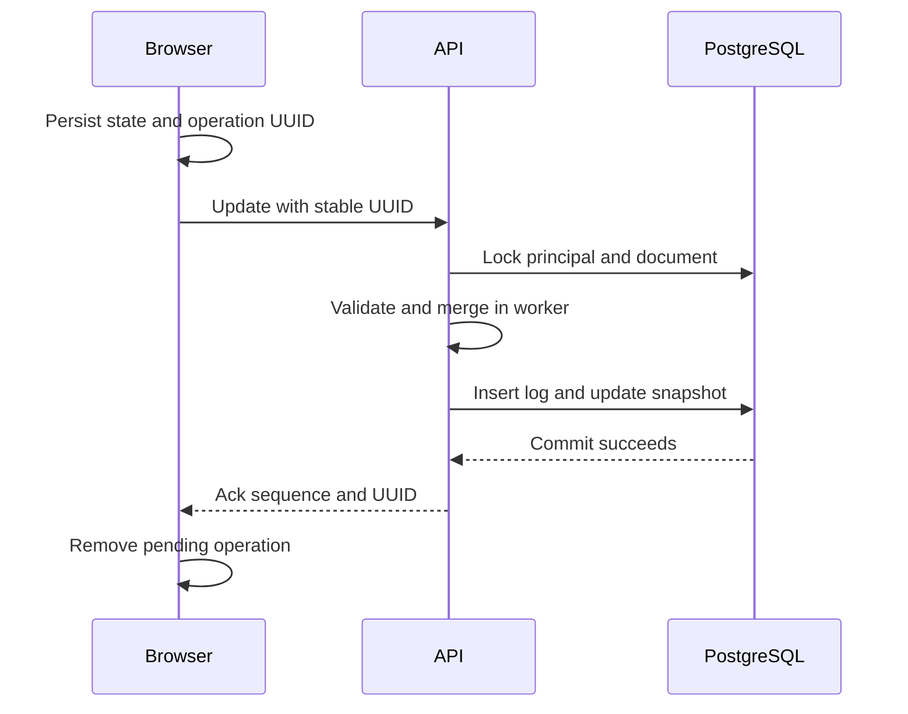

# Architecture and decisions

## Invariants

- All accepted updates are applied under a PostgreSQL document row lock. Snapshot, searchable text, sequence, and update log change in one transaction.
- Authorization comes from server-side principal records. The WebSocket ticket identifies a principal/document; client messages cannot select another tenant or actor.
- Authorization checks use a principal share lock. Revocation's row update waits for already-authorized transactions to finish; subsequent transactions fail. Existing sockets recheck on every write and every poll.
- A transport acknowledgment means the transaction committed. It does not mean every other browser has received the update, nor that a replica of PostgreSQL has persisted it.
- Redis is disposable. It stores expiring tickets and presence, and carries document-ID-only notifications. Existing sockets can continue database-backed collaboration while Redis is unavailable; new connections cannot obtain tickets.
- Browser retries retain operation IDs across reloads. The database deduplication key is `(document_id, op_id)`, with a payload digest and actor check.

## Why CRDTs

Yjs updates are commutative, associative, and idempotent ([upstream reference](https://docs.yjs.dev/api/document-updates)). Concurrent offline inserts and deletes therefore converge when the same updates are applied. PostgreSQL sequence numbers order transport/history, not conflict resolution. Local undo uses a Yjs UndoManager so it does not simply replace another user's entire document.

The server persists a complete Yjs snapshot after every accepted update, including unresolved update dependencies. It does not persist only the visible text. Tests explicitly send a dependent update before its predecessor, serialize/reload state, then apply the predecessor.

Each merge runs in a new worker thread with a 2.5-second deadline and V8 heap limits; four merges can be active per process. This deliberately bounds some untrusted parsing risks, at the cost of worker startup and snapshot-copy overhead. Native allocations, process-wide memory, and sustained hostile traffic still require container resource controls and edge defenses.

## Transaction ordering

An API crash before commit leaves no acknowledged edit. A crash after commit but before ack is repaired by duplicate retry. Polling readers read a consistent committed snapshot/log; new connections start from the snapshot sequence and request later updates. Slow clients are closed and reconstruct from a fresh snapshot plus their local outbox.

## Browser ownership and recovery

IndexedDB keys include tenant, principal, and document IDs. Saving a snapshot and an outgoing operation is atomic. Saving from two tabs merges their snapshots inside an IndexedDB read/write transaction, preventing last-writer overwrite of cached state. Each tab has its own Yjs client identity; concurrent resends are database-deduplicated.

Credentials live only in React/session memory. Reloading requires signing in again. This intentionally separates persistent document recovery from credential persistence. It does not protect documents from another user who can inspect the same browser profile.

Terminal operation rejections preserve the pending edit and block further synchronization. The user can export Markdown before remediation; silently deleting an unsent edit would hide data loss. A network error instead schedules a retry with jitter. The client sends one operation at a time and retains its ID until acknowledged.

## Deliberate constraints

One shared plain-text Yjs root (`body`), no rich-text embeds, attachments, external renderer execution, arbitrary event topics, or destructive restoration. Titles are immutable after creation in this version. Forking starts a new Yjs identity/history. API lists are bounded, and no multi-region/write-sharding claim is made.
